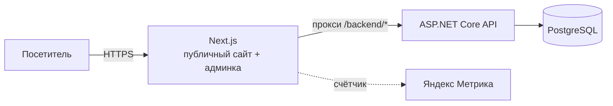
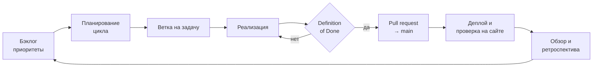
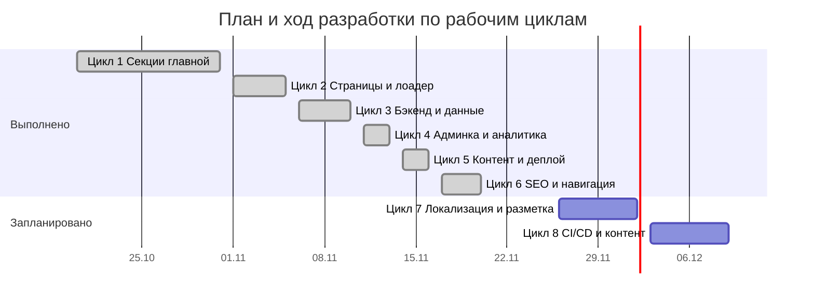

# Обоснование выбора модели разработки программного проекта

**Проект: персональный сайт-портфолио с админ-панелью и собственной системой аналитики**

**Автор:** Максим Новиков  ·  **Дата:** 25.11.2026

---

> [!NOTE]
> **Ссылки на проект**
> - Рабочий сайт: **<https://maxim-novikov.site>**
> - Исходный код: <https://github.com/Maxim-Coder-arch/personal-website>

## Содержание

1. [Название проекта](#1-название-проекта)
2. [Краткое описание проекта](#2-краткое-описание-проекта)
3. [Анализ требований](#3-анализ-требований)
4. [Сравнение моделей](#4-сравнение-моделей)
5. [Выбранная модель](#5-выбранная-модель)
6. [Обоснование выбора](#6-обоснование-выбора)
7. [Предварительный план разработки](#7-предварительный-план-разработки)
8. [Приложение А. Подготовка к защите: вопросы и ответы](#приложение-а-подготовка-к-защите-вопросы-и-ответы)
9. [Приложение Б. Факты из истории репозитория](#приложение-б-факты-из-истории-репозитория)

---

## 1. Название проекта

| | |
| --- | --- |
| **Название** | Personal Website, персональный сайт-портфолио Максима Новикова |
| **Тип продукта** | Веб-приложение: публичный сайт + административная панель + серверная часть (API) |
| **Рабочая версия** | <https://maxim-novikov.site> |
| **Исходный код** | <https://github.com/Maxim-Coder-arch/personal-website> |
| **Команда** | 1 человек (автор проекта) |
| **Заказчик** | Автор проекта (владелец сайта); целевая аудитория: работодатели, рекрутёры, коллеги |
| **Срок активной разработки** | 20.10.2026 — 20.11.2026 (около месяца) |

---

## 2. Краткое описание проекта

Сайт-портфолио, в котором всё сделано с нуля: от интерфейса до базы данных. Цель проекта: показать работы и навыки автора в виде, который сам по себе демонстрирует качество разработки (анимации, архитектура, работа с данными), и при этом дать автору полный контроль над контентом и статистикой через собственную админку.

### 2.1. Что получает пользователь

| Часть продукта | Состав |
| --- | --- |
| **Публичный сайт** | Главная из шести секций (Hero, проекты, технологический стек, опыт, мысли о разработке, Scenic); страница проектов; страница статей и страница отдельной статьи с Markdown и режимом чтения; страница 404; круговая навигация по секциям; уведомление об аналитике |
| **Админ-панель** | Авторизация; дашборд; отчёты «Посещения» и «Аудитория»; управление статьями (Markdown-редактор); управление проектами (загрузка изображения, сортировка) |
| **Серверная часть** | REST API на ASP.NET Core; база данных PostgreSQL; миграции; защита входа и сбора аналитики (rate limiting) |
| **Аналитика** | Собственный модуль учёта посещений без хранения IP-адресов + подключённая Яндекс Метрика |
| **SEO** | Метаданные страниц, Open Graph и Twitter Cards, sitemap, robots, canonical, подтверждение в Google Search Console и Яндекс Вебмастере |
| **Инфраструктура** | Docker и Docker Compose, развёртывание на собственном домене |

### 2.2. Технологический стек

| Слой | Технологии |
| --- | --- |
| Frontend | Next.js 16, React 19, TypeScript, Tailwind CSS 4, SCSS Modules, framer-motion, TanStack Query, next-intl |
| Backend | ASP.NET Core (.NET 10), Entity Framework Core, Npgsql |
| База данных | PostgreSQL 17 |
| Инфраструктура | Docker, Docker Compose |
| Архитектура фронтенда | Feature-Sliced Design (FSD) |

### 2.3. Архитектурная схема

---

## 3. Анализ требований

### 3.1. Заинтересованные стороны

| Сторона | Роль | Что ей нужно |
| --- | --- | --- |
| **Владелец сайта (автор)** | Заказчик, разработчик, администратор | Показать работы; управлять контентом без правки кода; видеть статистику |
| **Посетители: работодатели, рекрутёры** | Конечные пользователи | Быстро понять, кто автор и что он умеет; удобная навигация; хорошее впечатление от интерфейса |
| **Поисковые системы** | Косвенный потребитель | Корректные метаданные, sitemap, быстрая загрузка |

> [!IMPORTANT]
> Особенность проекта: **заказчик и исполнитель совпадают**. Нет внешнего человека, который утверждает требования и принимает работу. Это одновременно упрощает согласования и создаёт риск смещённой оценки качества, что учтено при выборе модели (см. раздел 6).

### 3.2. Ответы на вопросы анализа

#### 1. Насколько понятны требования заказчика?

**Оценка: средняя.** Ядро понятно с самого начала: сайт-портфолио с проектами, статьями и контактами. Детали выяснялись по ходу работы: как именно выглядят секции, какие анимации нужны, какие тексты, как устроена админка, что собирает аналитика. Значительная часть требований родилась только после того, как были видны первые результаты (см. таблицу изменений ниже).

#### 2. Может ли заказчик менять требования?

**Да, и менял многократно.** Заказчик (автор) свободно добавляет и убирает функции, и это нормально для личного проекта. Реальные изменения за время разработки:

| Изменение | Что произошло | Pull request |
| --- | --- | --- |
| Английская версия | Была запланирована, затем отложена на потом; вместо этого тексты вынесены в словарь, чтобы перевод стал дешёвым в будущем | #46 |
| Уведомление об аналитике | Новое требование после появления собственной аналитики; затем текст пересмотрен из-за подключения Яндекс Метрики | #47 |
| Метаданные и SEO | Появилось отдельное требование после выхода сайта на домен | #48, #50, #51 |
| Навигация по секциям главной | Новое требование: круговое меню, реализованное «технологично» | #49 |
| Карточки проектов | Переработаны после того, как стало видно, что при большом объёме данных интерфейс «ползёт» | #19 и последующие правки |
| Нижние блоки страниц | Убраны по итогам визуальной оценки как перегружающие страницу | в ходе правок интерфейса |

#### 3. Можно ли разделить продукт на отдельные функциональные части?

**Да, легко.** Продукт естественным образом состоит из независимых частей, каждую из которых можно разработать, проверить и выпустить отдельно:

- секции главной (6 независимых блоков);
- страницы проектов и статей;
- модули бэкенда (статьи, проекты, аналитика, администрирование);
- админ-панель (контент, отчёты);
- сквозные функции: аналитика, SEO, локализация, деплой.

Это поддерживается и архитектурой: FSD разбивает фронтенд на виджеты, а бэкенд на контроллеры и сервисы.

#### 4. Нужно ли регулярно показывать промежуточные результаты?

**Да.** Сайт с анимациями и визуальным дизайном нельзя оценить по описанию или макету: нужно видеть, как он выглядит и ощущается в браузере, на десктопе и на телефоне. Поэтому каждый готовый кусок проверяется «глазами» сразу после реализации и сразу попадает в основную ветку. Промежуточные результаты можно показывать и внешним людям (знакомым, преподавателю), не дожидаясь готовности всего.

#### 5. Насколько критичны сроки?

**Умеренно.** Жёсткого контракта и штрафов нет, но у портфолио есть важное свойство: **его ценность растёт с момента, когда оно становится доступно**. Чем раньше есть рабочая публичная версия, тем лучше. При этом сроки не должны приводить к потере качества, ведь сам сайт и есть демонстрация качества работы автора.

### 3.3. Функциональные требования

Приоритеты по методу MoSCoW: **M** (must, обязательно), **S** (should, желательно), **C** (could, возможно).

| № | Требование | Приоритет | Состояние |
| --- | --- | :---: | --- |
| FR-01 | Главная страница из шести секций | M | выполнено |
| FR-02 | Меню навигации между страницами | M | выполнено |
| FR-03 | Круговая навигация по секциям главной | C | выполнено (добавлено по ходу) |
| FR-04 | Страница проектов | M | выполнено |
| FR-05 | Страницы статей: список и отдельная статья с Markdown | M | выполнено |
| FR-06 | Страница 404 | C | выполнено |
| FR-07 | Авторизация администратора | M | выполнено |
| FR-08 | Управление статьями в админке | M | выполнено |
| FR-09 | Управление проектами (изображение, порядок) | M | выполнено |
| FR-10 | Сбор и просмотр аналитики посещений | S | выполнено |
| FR-11 | Уведомление посетителя об аналитике | S | выполнено |
| FR-12 | SEO: метаданные, sitemap, robots, Open Graph | S | выполнено |
| FR-13 | Английская локализация | C | запланировано (тексты уже в словаре) |

### 3.4. Нефункциональные требования

| Область | Требование |
| --- | --- |
| **Производительность** | Плавные анимации, быстрая загрузка страниц, отключение тяжёлых эффектов при `prefers-reduced-motion` |
| **Адаптивность** | Корректная работа на десктопе и мобильных устройствах |
| **Безопасность** | HttpOnly cookie для админки, ограничение частоты запросов (rate limiting), валидация данных, бэкенд недоступен напрямую из интернета |
| **Приватность** | IP-адрес посетителя не сохраняется; посетитель информируется о сборе данных |
| **Сопровождаемость** | Чёткая архитектура (FSD), строгая типизация, проверка кода линтером и компилятором |
| **Развёртываемость** | Запуск всей системы одной командой через Docker Compose |
| **Доступность** | Семантическая разметка, управление с клавиатуры, видимый фокус |

### 3.5. Вывод по анализу

| Характеристика проекта | Значение | Что это означает для процесса |
| --- | --- | --- |
| Ясность требований | Средняя | Нельзя зафиксировать всё заранее |
| Изменчивость требований | Высокая | Нужна возможность менять план на ходу |
| Делимость на части | Высокая | Подходит поставка частями |
| Потребность в промежуточных результатах | Высокая | Нужна короткая обратная связь |
| Критичность сроков | Умеренная | Выгоден ранний выпуск работающей версии |
| Размер команды | 1 человек | Процесс должен быть лёгким, без бюрократии |

---

## 4. Сравнение моделей

Ниже каждая модель описана применительно к **этому проекту**: как именно работа велась бы при каждом подходе (команда: один разработчик, заказчик: он же).

### 4.1. Сводная таблица

| Модель | Как будет организована разработка? | Преимущества | Недостатки |
| --- | --- | --- | --- |
| **Waterfall** | Этапы строго друг за другом, без возврата: 1. Собираются и фиксируются все требования. 2. Проектируется всё сразу: макеты всех страниц, схема БД, контракты API, архитектура. 3. Реализуется всё: сначала весь фронтенд, затем бэкенд, затем админка. 4. Тестирование всего продукта. 5. Единый релиз и развёртывание. Первый раз сайт увидит пользователь только после последнего этапа. | • Понятный и предсказуемый план. • Полная документация до начала кодирования. • Продуманная схема БД и API до написания кода. • Минимум переключений между задачами для одного человека. | • Требования у проекта меняются (английская версия, баннер, SEO, навигация), каждое изменение возвращает на этап назад. • Анимации и дизайн нельзя оценить на макете, ошибки видны только при реализации, то есть поздно. • Интеграция фронтенда и бэкенда проверяется в самом конце, когда исправления дороже всего. • Нет ни одной рабочей версии до самого конца. |
| **Итерационная** | Сначала строится **грубая версия всего продукта**: каркас всех страниц и простой API. Затем несколько проходов улучшают весь продукт целиком: 1. Итерация: каркас и базовое поведение. 2. Итерация: дизайн и анимации. 3. Итерация: качество, производительность, безопасность. После каждой итерации продукт целиком оценивается и корректируется. | • Рано виден общий каркас и целостность продукта. • Качество растёт постепенно. • Ошибки в архитектуре находятся рано. • Требования можно уточнять между итерациями. | • Всё множество функций остаётся «сырым» до последних итераций, отдельную готовую часть публиковать нельзя. • Риск переделывать одни и те же места много раз. • Без жёстких критериев завершения итерации легко «полировать бесконечно». • Не использует тот факт, что продукт делится на независимые части. |
| **Инкрементальная** | Продукт делится на функциональные части (инкременты); каждая делается **полностью** и сразу выпускается: 1. Секции главной. 2. Страницы проектов и статей. 3. Бэкенд и подключение к данным. 4. Админка и управление контентом. 5. Аналитика, SEO, деплой. Каждый новый инкремент добавляется к уже работающему продукту. | • Рабочая версия появляется рано и растёт. • Идеально ложится на FSD-виджеты и модули бэкенда. • Ранний выпуск и ранняя проверка на реальных данных. • Каждую часть можно проверить отдельно. | • Уже готовые части «замораживаются»: модель не предполагает их пересмотра, хотя в реальности они требуют правок. • Нужна продуманная общая архитектура, иначе инкременты плохо стыкуются. • Изменение требования к уже сделанной части не имеет встроенного процесса. • Нет регулярной ретроспективы и пересмотра приоритетов. |
| **Agile** | Короткие циклы (1 неделя), в каждом из которых выбирается набор задач из бэклога и выпускается **рабочий результат**: • Бэклог в виде списка задач с приоритетами. • Каждая задача: отдельная ветка, проверка, pull request, слияние в `main`. • Конец цикла: просмотр результата на реальном сайте и ретроспектива. • Бэклог и приоритеты пересматриваются в начале каждого цикла. | • Требования можно менять между циклами без «катастрофы». • Рабочий результат каждую неделю. • Непрерывная обратная связь: сразу видно, как выглядит сайт. • Технический долг гасится по ходу (отдельные задачи на рефакторинг). • Лёгкий процесс, подходит для одного человека (формат Scrumban). | • Нет внешнего заказчика, поэтому оценка результата субъективна. • Склонность к расширению объёма (scope creep): всегда хочется добавить ещё. • Меньше формальной документации. • Сложно точно предсказать дату завершения всего. • Требует самодисциплины в соблюдении цикла. |

### 4.2. Как это выглядело бы на практике

<b>Waterfall на этом проекте: подробный сценарий</b>

1. **Требования (1 неделя).** Автор пишет полную спецификацию: все страницы, все секции, поведение админки, сбор аналитики.
2. **Проектирование (1–2 недели).** Макеты всех страниц в дизайн-редакторе, схема БД, описание всех эндпоинтов, выбор архитектуры.
3. **Реализация (2–3 недели).** Сначала весь фронтенд, затем весь бэкенд, затем админка.
4. **Тестирование (1 неделя).** Проверка всего продукта, исправление найденных ошибок.
5. **Развёртывание.** Единственный релиз.

**Что пошло бы не так:** к моменту тестирования автор поймёт, что анимации выглядят не так, как в макете, что часть секций лучше переделать, что нужна английская версия и баннер об аналитике. Каждое из таких изменений требует возврата на этап проектирования и переписывания спецификации, при том что первый показ сайта состоится только в самом конце.

<b>Итерационная модель на этом проекте: подробный сценарий</b>

1. **Итерация 1.** Все страницы-заглушки с базовой версткой, простейший API без защиты, данные в тестовом виде.
2. **Итерация 2.** Дизайн и анимации на всех страницах сразу, админка в простом виде.
3. **Итерация 3.** Безопасность, аналитика, SEO, производительность.

**Что пошло бы не так:** до последней итерации сайт целиком выглядит недоделанным; опубликовать «хотя бы главную» нельзя, потому что все части находятся на одном уровне готовности. Одни и те же компоненты приходится переделывать на каждой итерации.

<b>Инкрементальная модель на этом проекте: подробный сценарий</b>

1. **Инкремент 1.** Шесть секций главной, готовых окончательно.
2. **Инкремент 2.** Страницы проектов и статей.
3. **Инкремент 3.** Бэкенд, база данных, подключение сайта к реальным данным.
4. **Инкремент 4.** Админка и управление контентом.
5. **Инкремент 5.** Аналитика, SEO, деплой.

**Чего не хватает:** модель не описывает, как менять уже выпущенные части. Но в реальности секции главной приходилось дорабатывать после появления бэкенда (карточки проектов, Hero, футер), а требования к уже сделанному менялись. Для этого нужен механизм пересмотра, то есть итеративность.

<b>Agile на этом проекте: подробный сценарий</b>

1. **Начало цикла (планирование).** Из бэклога выбираются 3–6 задач на неделю, например «секция проектов», «страница статей».
2. **Работа.** Для каждой задачи создаётся ветка, реализуется результат, проходят проверки (`tsc`, `eslint`, сборка), открывается pull request и сливается в `main`.
3. **Конец цикла (обзор).** Результат смотрится на реальном сайте, в браузере на десктопе и телефоне.
4. **Ретроспектива.** Что получилось, что мешало, что убрать и что добавить; бэклог пересматривается.
5. **Новый цикл.** Приоритеты расставляются заново с учётом того, что изменилось.

**Почему подходит:** требования меняются естественно, каждое изменение превращается в задачу в бэклоге, а не в срыв плана.

---

## 5. Выбранная модель

### Agile
**(облегчённый формат Scrumban для одного разработчика)**

### 5.1. Как модель адаптирована под проект

Классический Scrum рассчитан на команду из нескольких человек с ролями Product Owner и Scrum Master. В проекте один участник, поэтому берутся только практики, которые дают реальную пользу:

| Практика | Как выглядит в проекте |
| --- | --- |
| **Бэклог** | Список задач с приоритетами (GitHub Issues или Projects). Пополняется в любой момент. |
| **Короткий цикл** | Одна неделя; в начале выбирается набор задач, в конце проверяется результат. |
| **Ограничение незавершённой работы (WIP)** | Одновременно в работе не больше 1–2 задач, чтобы не копить недоделок. |
| **Ветка на задачу** | `feature/*` для новых функций, `fix/*` для исправлений. |
| **Pull request** | Каждое изменение попадает в `main` только через pull request. |
| **Definition of Done** | Задача считается выполненной, когда выполнены все пункты списка ниже. |
| **Обзор результата** | Визуальная проверка на реальном сайте в конце цикла. |
| **Ретроспектива** | Короткий разбор цикла: что оставить, что изменить. |
| **Непрерывный деплой** | Docker-образ собирается из `main`, результат проверяется на домене. |

### 5.2. Definition of Done

Задача завершена, когда:

- [x] код компилируется без ошибок типизации (`tsc --noEmit`);
- [x] линтер не выдаёт ошибок (`eslint`);
- [x] проект успешно собирается (`next build`);
- [x] функция проверена вручную в браузере на десктопе и мобильной ширине;
- [x] для бэкенда: эндпоинты проверены ручными запросами (файл `backend.http` и интерфейс Scalar);
- [x] изменение влито в `main` через pull request;
- [x] после деплоя результат проверен на рабочем домене.

### 5.3. Схема цикла

---

## 6. Обоснование выбора

### 6.1. Особенности проекта, повлиявшие на выбор

| Особенность | Почему важна | Как учтена в Agile |
| --- | --- | --- |
| **Высокая изменчивость требований** | Английская версия отложена, баннер, SEO и навигация добавлены по ходу | Бэклог пересматривается каждый цикл, изменение превращается в новую задачу |
| **Средняя ясность требований** | Дизайн и поведение выясняются при взгляде на результат | Короткий цикл «сделать, посмотреть, поправить» вместо долгой подготовки |
| **Высокая делимость** | Секции, страницы, модули бэкенда независимы | Каждая часть выпускается как законченный результат |
| **Визуальная часть** | Анимации и интерфейс нельзя оценить по описанию | Обратная связь каждую неделю на реальном сайте |
| **Один участник** | Нет места тяжёлым процессам и согласованиям | Облегчённая форма: бэклог, цикл, Definition of Done |
| **Заказчик = исполнитель** | Нет внешнего приёмщика работы | Формальные критерии Definition of Done вместо субъективного «вроде готово» |
| **Умеренная критичность сроков** | Выгоден ранний выпуск работающей версии | Каждый цикл завершается рабочим состоянием `main` |
| **Сквозные задачи** (деплой, SEO, аналитика) | Появляются после запуска и зависят от реальных данных | Берутся в работу в нужный момент, а не «по плану» |

### 6.2. Матрица выбора

Оценка соответствия модели каждой характеристике проекта по шкале от 1 (плохо подходит) до 5 (отлично подходит). Оценки экспертные, они иллюстрируют ход рассуждения.

| Критерий (характеристика проекта) | Waterfall | Итерационная | Инкрементальная | Agile |
| --- | :---: | :---: | :---: | :---: |
| Высокая изменчивость требований | 1 | 3 | 3 | **5** |
| Средняя ясность требований | 2 | 4 | 3 | **5** |
| Высокая делимость на части | 2 | 3 | **5** | **5** |
| Нужны регулярные промежуточные результаты | 1 | 3 | **5** | **5** |
| Умеренная критичность сроков (выгоден ранний выпуск) | 2 | 3 | 4 | **5** |
| Малые накладные расходы для одного человека | 4 | 3 | 4 | 4 |
| **Итого (из 30)** | **12** | **19** | **24** | **29** |

### 6.3. Преимущества выбранного подхода для этого проекта

1. **Изменения требований не ломают план.** Любое новое пожелание (баннер, навигация, SEO) становится задачей в бэклоге и попадает в ближайший цикл.
2. **Рабочий результат каждую неделю.** Сайт всегда находится в состоянии, которое можно показать.
3. **Ранняя проверка интерфейса.** Анимации и дизайн оцениваются на реальном сайте, а не по макету.
4. **Ошибки находятся рано.** Интеграция фронтенда и бэкенда проверяется по мере появления функций, а не в конце.
5. **Технический долг управляется.** Рефакторинг становится обычными задачами в бэклоге, а не откладывается «на потом».
6. **Совмещение с инкрементальным и итерационным подходом.** Agile сам объединяет их: функции поставляются частями (инкременты) и дорабатываются повторными проходами (итерации).
7. **Легко масштабируется.** Если появится вторая участница или участник, процесс уже готов: ветки, pull request, Definition of Done.

### 6.4. Возможные ограничения и меры

| Ограничение | Риск | Что с этим делать |
| --- | --- | --- |
| **Нет внешнего заказчика** | Оценка результата субъективна, возможна «слепота» к недостаткам | Формальный Definition of Done; показ результата другим людям на обзоре цикла; проверка метриками (Lighthouse, Метрика) |
| **Расползание объёма (scope creep)** | Хочется добавлять бесконечно | Ограничение WIP; жёсткий отбор задач на цикл; новые идеи сначала попадают в бэклог, а не сразу в работу |
| **Слабая формальная документация** | Трудно вспомнить решения позже | README, структура проекта (FSD), этот документ, понятные названия веток и коммитов |
| **Сложный прогноз срока всего проекта** | Нельзя точно сказать, когда «всё готово» | Прогноз на уровне ближайших циклов; скорость оценивается по прошлым циклам (в среднем около 8–9 pull request в цикл) |
| **Накопление технического долга** | Быстрая поставка ведёт к «грязному» коду | Регулярные циклы с задачами на рефакторинг (как PR #11, #39–#41) |
| **Самодисциплина** | Некому напоминать о ритуалах | Лёгкий формат: короткий цикл, короткая ретроспектива, автоматические проверки (`tsc`, `eslint`, сборка) |

---

## 7. Предварительный план разработки

Для выбранной модели Agile определены **рабочие циклы** с ожидаемым результатом каждого. Первые шесть циклов уже выполнены (даты и номера pull request соответствуют истории репозитория), два следующих запланированы.

### 7.1. Диаграмма циклов

### 7.2. Выполненные циклы

#### Цикл 1. Секции главной страницы (20.10 – 31.10)

| | |
| --- | --- |
| **Цель** | Получить визуальную основу сайта |
| **Ожидаемый результат** | Готовые секции главной: Hero, меню, проекты, технологический стек, опыт, мысли о разработке, Scenic |
| **Что выпущено** | Pull request #1–#8 |
| **Критерий готовности** | Каждая секция отображается корректно и анимируется; код проходит проверки |
| **Как проверялось** | Визуальный просмотр в браузере после каждой секции |

#### Цикл 2. Страницы и интерфейсные элементы (01.11 – 05.11)

| | |
| --- | --- |
| **Цель** | Расширить сайт за пределы главной и добавить общие элементы |
| **Ожидаемый результат** | Футер, интро-лоадер, элемент-маскот, страницы проектов и статей (на тестовых данных), доработка Hero, рефакторинг |
| **Что выпущено** | Pull request #9–#17 |
| **Критерий готовности** | Страницы открываются, навигация работает |
| **Как проверялось** | Ручная проверка переходов и анимаций, `tsc` и `eslint` |

#### Цикл 3. Бэкенд и реальные данные (06.11 – 10.11)

| | |
| --- | --- |
| **Цель** | Заменить тестовые данные настоящими |
| **Ожидаемый результат** | API на ASP.NET Core, модели и миграции БД, контроллеры, подключение сайта через TanStack Query, страница 404, доработка карточек проектов |
| **Что выпущено** | Pull request #18–#32 |
| **Критерий готовности** | Страницы получают данные из БД через API |
| **Как проверялось** | Ручные запросы к API (`backend.http`, Scalar), проверка отображения данных на сайте |

#### Цикл 4. Админка и аналитика (11.11 – 13.11)

| | |
| --- | --- |
| **Цель** | Дать владельцу управление и статистику |
| **Ожидаемый результат** | Авторизация администратора, дашборд, сбор аналитики, первая конфигурация для продакшена, рефакторинг |
| **Что выпущено** | Pull request #33–#41 |
| **Критерий готовности** | Администратор входит, видит отчёты; аналитика записывает визиты |
| **Как проверялось** | Вход в админку, проверка записи посещений, проверка ограничения частоты запросов (rate limiting) |

#### Цикл 5. Управление контентом и выход в продакшен (14.11 – 16.11)

| | |
| --- | --- |
| **Цель** | Сделать сайт управляемым и запустить его |
| **Ожидаемый результат** | Управление статьями и проектами из админки, Docker-развёртывание, вынесение текстов в словарь |
| **Что выпущено** | Pull request #42–#46 |
| **Критерий готовности** | Контент редактируется без правки кода; система запускается через Docker Compose |
| **Как проверялось** | Развёртывание контейнеров, проверка картинок и страниц статей в продакшен-режиме, предварительный аудит конфигурации |

#### Цикл 6. Уведомление, навигация и SEO (17.11 – 20.11)

| | |
| --- | --- |
| **Цель** | Довести продукт до «публичного» качества |
| **Ожидаемый результат** | Баннер об аналитике, метаданные страниц, круговая навигация по секциям, SEO (sitemap, robots, Open Graph), домен, Яндекс Метрика, README |
| **Что выпущено** | Pull request #47–#51 |
| **Критерий готовности** | Сайт доступен на домене, метаданные корректны, поисковики подтверждены |
| **Как проверялось** | Проверка HTML-метаданных, превью ссылок, консоли поисковиков и Метрики |

### 7.3. Запланированные циклы

#### Цикл 7. Локализация и структурированные данные (26.11 – 02.12)

| | |
| --- | --- |
| **Цель** | Расширить аудиторию и улучшить видимость в поиске |
| **Ожидаемый результат** | Английская версия сайта (маршрутизация по локали, словарь `en.json`), структурированные данные JSON-LD для главной и статей |
| **Критерий готовности** | Оба языка доступны по своим адресам, метаданные переведены, разметка проходит проверку |
| **Как проверить** | Переключение языков, проверка `hreflang`, тест расширенных результатов поиска |

#### Цикл 8. Автоматизация и качество контента (03.12 – 09.12)

| | |
| --- | --- |
| **Цель** | Сократить ручную работу и улучшить поисковую выдачу |
| **Ожидаемый результат** | CI/CD на GitHub Actions (проверки и деплой), человекочитаемые адреса статей (slug), отдельные картинки превью для статей, оптимизация по результатам Lighthouse |
| **Критерий готовности** | Каждый merge в `main` автоматически проверяется и выкатывается; показатели Lighthouse не ниже целевых |
| **Как проверить** | Прогон пайплайна, проверка редиректов со старых адресов, замеры производительности |

### 7.4. Бэклог на будущее

- Перевод контента статей и проектов на стороне бэкенда.
- Расширение отчётов аналитики.
- Политика конфиденциальности (отдельная страница).
- Новые материалы: статьи и проекты.

---

## Приложение А. Подготовка к защите: вопросы и ответы

### Почему вы не выбрали Waterfall?

Waterfall требует, чтобы требования были известны и стабильны с самого начала. У этого проекта они **средне понятны и постоянно меняются**: английская версия была отложена, баннер об аналитике, навигация по секциям и SEO появились уже в процессе. При Waterfall каждое такое изменение возвращает проект на этап проектирования. Кроме того, у сайта визуальная часть, которую нельзя оценить по макету, а при Waterfall первую рабочую версию мы увидели бы только в самом конце. И наконец, продукт хорошо делится на независимые части, что даёт возможность выпускать их по очереди, а Waterfall этого не использует.

### Что вы будете делать, если заказчик изменит требования?

Изменение проходит через бэклог: новое требование записывается как задача, оценивается по размеру и приоритету, и либо включается в ближайший цикл (если важно), либо ждёт своей очереди. Если оно противоречит уже сделанному, оно оформляется как отдельная задача на доработку; уже работающая версия в `main` при этом не ломается. Примеры из этого проекта: отложенная английская версия (вместо неё сделали словарь текстов), добавленный по ходу баннер аналитики и навигация по секциям.

### Можно ли выпустить первую версию раньше?

Да, и в этом одно из главных преимуществ выбранной модели. Минимально полезная версия (статичная главная и страница проектов) была готова уже к концу второго цикла; при желании её можно было опубликовать на этом этапе, не дожидаясь бэкенда и админки. Публичное развёртывание на домене состоялось позже, когда была готова управляемая версия с данными. Первая версия не обязана быть полной, она должна быть работающей и полезной.

### Как вы будете проверять промежуточные результаты?

Через Definition of Done, который применяется к каждой задаче: проверка типов (`tsc`), линтер (`eslint`), сборка проекта, ручная проверка в браузере на десктопе и мобильной ширине, для бэкенда ручные запросы к API, после этого pull request, слияние в `main` и проверка на реальном домене. В конце каждого цикла проводится обзор результата на рабочем сайте, а после запуска к этому добавились измерения: Lighthouse, Яндекс Метрика и собственная аналитика.

### Можно ли совместить итерационную и инкрементальную разработку?

Да, и на практике так и делалось. Продукт **поставлялся инкрементами**: секции, страницы, бэкенд, админка, SEO. И при этом **доводился итерациями**: каждая часть возвращалась на доработку по мере появления новых знаний. Это хорошо видно по истории репозитория: секция Hero дорабатывалась в четырёх разных pull request (#1, #2, #10, #20), футер в трёх (#9, #32, #33), админка в шести. Agile объединяет оба подхода: инкремент отвечает на вопрос «что выпускаем», итерация на вопрос «как улучшаем уже выпущенное».

### Почему не классический Scrum?

Scrum рассчитан на команду с ролями Product Owner и Scrum Master, ежедневными митингами и планированием на много людей. Для одного разработчика это формальности без пользы. Поэтому взят облегчённый вариант (Scrumban): бэклог, короткий цикл, ограничение незавершённой работы, обзор и ретроспектива.

### Как обеспечить качество, если заказчик и исполнитель один человек?

Формальные критерии вместо субъективных ощущений: Definition of Done, автоматические проверки (`tsc`, `eslint`, сборка), измеримые метрики после запуска (Lighthouse, Метрика) и демонстрация результата другим людям на обзоре цикла.

### Как оценивать сроки при Agile?

По скорости предыдущих циклов. За месяц разработки выпущено 51 pull request в шести циклах, то есть в среднем около 8–9 за цикл. Это позволяет прогнозировать объём ближайших циклов, не пытаясь предсказывать срок всего проекта целиком.

---

## Приложение Б. Факты из истории репозитория

Данные взяты из истории `main` на момент 20.11.2026 и подтверждают, что реальный процесс был ближе к Agile, чем к Waterfall.

### Общие метрики

| Показатель | Значение |
| --- | ---: |
| Период активной разработки | 20.10.2026 — 20.11.2026 (31 день) |
| Коммитов | 224 |
| Pull request'ов, влитых в `main` | 51 |
| Среднее число pull request в цикл | около 8–9 |

### Повторные заходы на одни и те же части (итеративность)

| Часть продукта | Pull request'ы | Заходов |
| --- | --- | :---: |
| Hero-секция | #1, #2, #10, #20 | 4 |
| Админка | #34, #35, #37, #38, #42, #43 | 6 |
| Модели бэкенда | #22, #23, #26, #28, #29 | 5 |
| Конфигурация продакшена | #36, #44, #45 | 3 |
| Футер | #9, #32, #33 | 3 |
| Статьи | #16, #17, #18 | 3 |
| Рефакторинг | #11, #39, #40, #41 | 4 |
| Страница проектов | #14, #15 | 2 |
| Контроллеры бэкенда | #24, #25 | 2 |
| Запросы к API (TanStack Query) | #27, #30 | 2 |

### Что это говорит о процессе

- Работа велась **небольшими порциями**: каждая функция в отдельной ветке и отдельном pull request.
- Одни и те же части **многократно улучшались** (итеративность), при этом продукт **рос частями** (инкрементальность).
- Требования уточнялись и менялись по ходу, что характерно для Agile и несовместимо с жёстким последовательным планом Waterfall.
- Рефакторинг выделялся в отдельные задачи (#11, #39–#41), то есть технический долг обслуживался регулярно.

---

Сайт проекта: **[maxim-novikov.site](https://maxim-novikov.site)**  ·  Код: **[GitHub](https://github.com/Maxim-Coder-arch/personal-website)**

