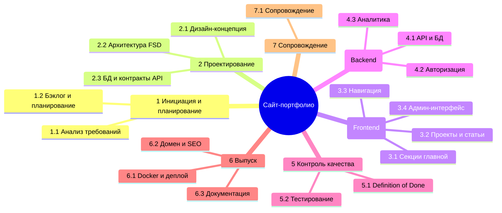
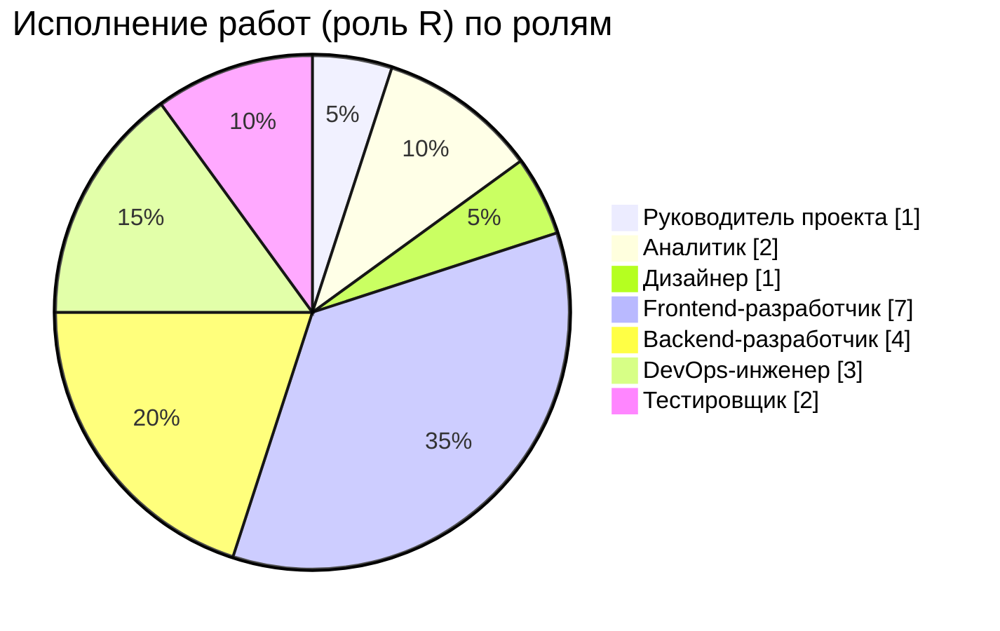
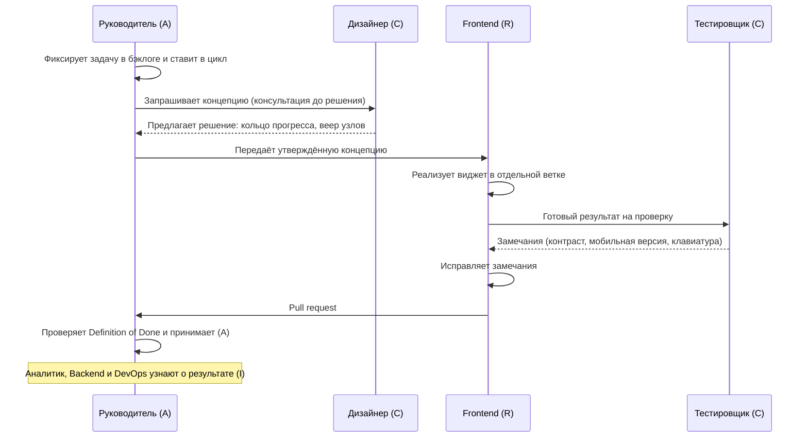

# Распределение ответственности по проекту

**Матрица RACI для проекта «Персональный сайт-портфолио»**

**Автор:** Максим Новиков  ·  **Дата:** 27.11.2026

---

> [!NOTE]
> **Ссылки на проект**
> - Рабочий сайт: **<https://maxim-novikov.site>**
> - Исходный код: <https://github.com/Maxim-Coder-arch/personal-website>

## Содержание

1. [Контекст: RACI в проекте из одного человека](#1-контекст-raci-в-проекте-из-одного-человека)
2. [Обозначения и правила](#2-обозначения-и-правила)
3. [Роли проекта](#3-роли-проекта)
4. [Работы проекта (WBS)](#4-работы-проекта-wbs)
5. [Матрица RACI](#5-матрица-raci)
6. [Проверка матрицы](#6-проверка-матрицы)
7. [Нагрузка по ролям](#7-нагрузка-по-ролям)
8. [Риски совмещения ролей и меры](#8-риски-совмещения-ролей-и-меры)
9. [Пример работы матрицы](#9-пример-работы-матрицы)
10. [Приложение. Подготовка к защите: вопросы и ответы](#10-приложение-подготовка-к-защите-вопросы-и-ответы)

---

## 1. Контекст: RACI в проекте из одного человека

**Проект:** персональный сайт-портфолио с админ-панелью, собственной аналитикой и серверной частью. Публичная версия: <https://maxim-novikov.site>. Подробное описание проекта и выбранной модели разработки (Agile) приведено в документе «Обоснование выбора модели разработки».

**Особенность:** проект выполняется **одним человеком**, Максимом Новиковым, и в этом же лице совпадает с заказчиком. Поэтому матрица RACI здесь строится не «по людям», а **по ролям**: в разные моменты проекта автор выступает как руководитель, аналитик, дизайнер, frontend-разработчик, backend-разработчик, DevOps-инженер и тестировщик. Каждая роль имеет свою зону ответственности, и матрица фиксирует, **в какой роли автор принимает решение, в какой выполняет работу, а в какой консультирует или получает информацию**.

### Зачем это нужно в соло-проекте

| Польза | Как проявляется на этом проекте |
| --- | --- |
| **Ничего не забыть** | Явные роли «Тестировщик» и «DevOps» напоминают, что проверки и развёртывание — отдельные работы, а не «побочный эффект» разработки |
| **Разделить исполнение и приёмку** | Один и тот же человек сначала делает работу (R), а затем принимает её как руководитель (A) по заранее заданным критериям |
| **Увидеть перегруженные роли** | По матрице видно, на какую роль приходится больше всего работы (см. раздел 7) |
| **Подготовить проект к росту** | Если появится второй участник, достаточно переназначить исполнителей ролей: структура ответственности уже готова |
| **Снизить субъективность** | Критерии приёмки и обязанности роли зафиксированы, а не «в голове» |

> [!IMPORTANT]
> В классическом RACI на каждую работу приходится один ответственный за результат (**A**) и один или несколько исполнителей (**R**). Роль **A** и роль **R** могут совпадать, это допустимо и обозначается **A/R**. Здесь все роли исполняет один человек, поэтому важна не «разная личность», а **разные функции**: решение, выполнение, консультация, информирование.

---

## 2. Обозначения и правила

### 2.1. Расшифровка

| Код | Значение | Что означает на этом проекте |
| :-: | --- | --- |
| **R** | Responsible, исполнитель | Роль, которая непосредственно выполняет работу |
| **A** | Accountable, ответственный за результат | Роль, которая принимает результат и отвечает за него; решение остаётся за ней |
| **C** | Consulted, консультирует | К роли обращаются **до** принятия решения или завершения работы; общение двустороннее |
| **I** | Informed, информируется | Роль получает уведомление о результате **после** принятия решения |
| **A/R** | Совмещение | Роль и принимает результат, и выполняет работу |

### 2.2. Правила построения матрицы

1. У **каждой работы есть хотя бы один исполнитель** (R).
2. У **каждой работы ровно один ответственный** (A).
3. В одной ячейке **одно обозначение** (кроме допустимого A/R): роль не может быть, например, и R, и I на одной работе.
4. **Каждая роль имеет обязанности**: хотя бы в одной работе она R или A.
5. Принятие результата (A) отделено по времени от выполнения (R): работа принимается через pull request и проверку критериев Definition of Done.

---

## 3. Роли проекта

Все роли выполняет один человек (**Максим Новиков**), но зоны ответственности чётко разделены.

| Роль | Зона ответственности | Ключевые артефакты | Исполнитель |
| --- | --- | --- | --- |
| **Руководитель проекта** (владелец продукта) | Приоритеты, объём работ, план циклов, приёмка результата, решение о выпуске | Бэклог, план циклов, решение о слиянии в `main` | Максим Новиков |
| **Аналитик** | Требования, критерии приёмки, документация | Список требований FR и NFR, README, документы по процессу | Максим Новиков |
| **Дизайнер** | Визуальный язык, поведение интерфейса, анимации, адаптивность | Решения по стилю, схемы секций и взаимодействий | Максим Новиков |
| **Frontend-разработчик** | Интерфейс на Next.js и React, архитектура фронтенда (FSD), подключение к API | Виджеты, страницы, стили, хуки | Максим Новиков |
| **Backend-разработчик** | API на ASP.NET Core, база данных, безопасность сервера | Контроллеры, модели, миграции, сервисы | Максим Новиков |
| **DevOps-инженер** | Контейнеризация, развёртывание, домен, мониторинг | Dockerfile, Docker Compose, настройки сервера и DNS | Максим Новиков |
| **Тестировщик** | Критерии готовности, проверки, поиск дефектов | Definition of Done, чек-листы, результаты проверок | Максим Новиков |

---

## 4. Работы проекта (WBS)

Для матрицы выбрано **18 работ** (по заданию нужно минимум 10). Они взяты не из шаблона, а из реальной структуры этого проекта и привязаны к рабочим циклам плана разработки.

### 4.1. Структура работ

### 4.2. Список работ

| № | Работа | Результат работы | Основной цикл |
| :-: | --- | --- | --- |
| | **Этап 1. Инициация и планирование** | | |
| 1.1 | Анализ требований и формирование концепции | Список FR и NFR, концепция сайта | до цикла 1 |
| 1.2 | Планирование и ведение бэклога | Бэклог, план рабочих циклов | весь проект |
| | **Этап 2. Проектирование** | | |
| 2.1 | Дизайн-концепция и UI-решения (стиль, секции, анимации) | Визуальный язык, поведение секций | циклы 1–2 |
| 2.2 | Проектирование архитектуры фронтенда (FSD) | Слои, правила импортов, структура виджетов | цикл 1 |
| 2.3 | Проектирование базы данных и контрактов API | Модели, связи, список эндпоинтов | цикл 3 |
| | **Этап 3. Разработка интерфейса (Frontend)** | | |
| 3.1 | Секции главной страницы | Hero, проекты, стек, опыт, мысли, Scenic | циклы 1–2 |
| 3.2 | Страницы проектов и статей (Markdown) | Страницы, рендер Markdown, режим чтения | циклы 2–3 |
| 3.3 | Навигация: меню страниц и круговая навигация по секциям | Меню, виджет навигации по секциям | циклы 1 и 6 |
| 3.4 | Админ-интерфейс (контент и отчёты) | Страницы управления статьями, проектами, дашборд | циклы 4–5 |
| | **Этап 4. Разработка серверной части (Backend)** | | |
| 4.1 | API и работа с базой данных | Контроллеры, EF Core, миграции | цикл 3 |
| 4.2 | Авторизация и защита админки | Вход, cookie-сессия, rate limiting | цикл 4 |
| 4.3 | Модуль аналитики (трекер, сбор данных, отчёты) | Клиентский трекер и серверный сбор данных | цикл 4 |
| | **Этап 5. Контроль качества** | | |
| 5.1 | Подготовка проверок: Definition of Done и чек-листы | DoD, чек-листы, сценарии проверки | цикл 1 и далее |
| 5.2 | Тестирование: типы, линтер, сборка, ручная проверка, Lighthouse | Результаты проверок каждого цикла | каждый цикл |
| | **Этап 6. Выпуск** | | |
| 6.1 | Контейнеризация и развёртывание (Docker) | Dockerfile, Docker Compose, деплой | цикл 5 |
| 6.2 | Домен, SEO и внешние сервисы | DNS, метаданные, sitemap, Search Console, Метрика | цикл 6 |
| 6.3 | Документация (README, документы по процессу) | README, описание архитектуры и процесса | цикл 6 |
| | **Этап 7. Сопровождение** | | |
| 7.1 | Мониторинг и сопровождение после запуска | Анализ отчётов, обновления, исправления | после цикла 6 |

---

## 5. Матрица RACI

**Обозначения:** **R** — исполняет, **A** — отвечает за результат и принимает его, **C** — консультирует, **I** — информируется, **A/R** — и принимает, и выполняет.

| № | Работа | Руководитель проекта | Аналитик | Дизайнер | Frontend-разработчик | Backend-разработчик | DevOps-инженер | Тестировщик |
| :-: | --- | :-: | :-: | :-: | :-: | :-: | :-: | :-: |
| | **Этап 1. Инициация и планирование** |  |  |  |  |  |  |  |
| 1.1 | Анализ требований и формирование концепции | **A** | **R** | C | C | C | I | C |
| 1.2 | Планирование и ведение бэклога | **A/R** | C | I | I | I | I | I |
| | **Этап 2. Проектирование** |  |  |  |  |  |  |  |
| 2.1 | Дизайн-концепция и UI-решения (стиль, секции, анимации) | **A** | C | **R** | C | I | I | I |
| 2.2 | Проектирование архитектуры фронтенда (FSD) | **A** | I | I | **R** | C | C | I |
| 2.3 | Проектирование базы данных и контрактов API | **A** | C | I | C | **R** | C | I |
| | **Этап 3. Разработка интерфейса (Frontend)** |  |  |  |  |  |  |  |
| 3.1 | Секции главной страницы | **A** | I | C | **R** | I | I | C |
| 3.2 | Страницы проектов и статей (Markdown) | **A** | I | C | **R** | C | I | C |
| 3.3 | Навигация: меню страниц и круговая навигация по секциям | **A** | I | C | **R** | I | I | C |
| 3.4 | Админ-интерфейс (контент и отчёты) | **A** | C | C | **R** | C | I | C |
| | **Этап 4. Разработка серверной части (Backend)** |  |  |  |  |  |  |  |
| 4.1 | API и работа с базой данных | **A** | I | I | C | **R** | C | C |
| 4.2 | Авторизация и защита админки | **A** | I | I | C | **R** | C | C |
| 4.3 | Модуль аналитики (трекер, сбор данных, отчёты) | **A** | C | C | **R** | **R** | I | C |
| | **Этап 5. Контроль качества** |  |  |  |  |  |  |  |
| 5.1 | Подготовка проверок: Definition of Done и чек-листы | **A** | C | I | C | C | C | **R** |
| 5.2 | Тестирование: типы, линтер, сборка, ручная проверка, Lighthouse | **A** | I | C | C | C | I | **R** |
| | **Этап 6. Выпуск** |  |  |  |  |  |  |  |
| 6.1 | Контейнеризация и развёртывание (Docker) | **A** | I | I | C | C | **R** | C |
| 6.2 | Домен, SEO и внешние сервисы | **A** | C | I | **R** | I | **R** | C |
| 6.3 | Документация (README, документы по процессу) | **A** | **R** | C | C | C | I | I |
| | **Этап 7. Сопровождение** |  |  |  |  |  |  |  |
| 7.1 | Мониторинг и сопровождение после запуска | **A** | C | I | C | C | **R** | I |

### 5.1. Как читать матрицу

- **Столбец «Руководитель проекта»** содержит **A** во всех строках: руководитель принимает результат любой работы и отвечает за него. Исполнителем (R) он выступает только там, где работа совпадает с его функцией, то есть при планировании (**A/R**).
- **Профильная роль** (дизайнер, разработчик, DevOps, тестировщик) почти всегда **R**: она делает работу по своей специальности.
- **C** стоит там, где знания смежной роли влияют на качество: например, DevOps консультирует при проектировании БД (как её развернуть и сохранять данные), а тестировщик консультирует при реализации интерфейса (что и как будет проверяться).
- **I** означает, что роли достаточно знать итог, чтобы не отставать от проекта (например, дизайнер информируется о результатах настройки контейнеров).
- **Несколько R** в одной работе допустимы, когда работа действительно состоит из нескольких частей: у модуля аналитики есть клиентская часть (Frontend) и серверная (Backend); у «Домена и SEO» есть метаданные в коде (Frontend) и настройка DNS (DevOps).

---

## 6. Проверка матрицы

Матрица проверена по пяти критериям из задания. Проверка выполнялась программно: для каждой строки подсчитано число обозначений R, A, C, I, для каждой роли число обязанностей. Результат: **ошибок не найдено**.

### 6.1. Итог по критериям

| № | Критерий | Результат | Как проверено |
| :-: | --- | :-: | --- |
| 1 | У каждой работы есть исполнитель **R** | ✅ | В каждой из 18 строк не менее одного R (см. таблицу 6.2) |
| 2 | У каждой работы **ровно один A** | ✅ | В каждой строке ровно одна роль содержит A (столбец «A» в таблице 6.2 везде равен 1) |
| 3 | Нет работ без ответственного | ✅ | Следует из пунктов 1 и 2: у каждой работы есть и исполнитель, и ответственный |
| 4 | Нет ролей без обязанностей | ✅ | У каждой роли есть хотя бы одна работа с R или A (таблица 6.3) |
| 5 | Обязанности не противоречат друг другу | ✅ | В ячейке одно обозначение (кроме допустимого A/R); приёмку (A) всегда выполняет одна роль; консультирующие (C) не совпадают с исполнителем (R) в той же строке |

### 6.2. Проверка по работам

| № | Работа | R | A | C | I | Исполнители (R) | Ответственный (A) |
| :-: | --- | :-: | :-: | :-: | :-: | --- | --- |
| 1.1 | Анализ требований и формирование концепции | 1 | 1 | 4 | 1 | АН | РП |
| 1.2 | Планирование и ведение бэклога | 1 | 1 | 1 | 5 | РП | РП |
| 2.1 | Дизайн-концепция и UI-решения (стиль, секции, анимации) | 1 | 1 | 2 | 3 | ДЗ | РП |
| 2.2 | Проектирование архитектуры фронтенда (FSD) | 1 | 1 | 2 | 3 | FE | РП |
| 2.3 | Проектирование базы данных и контрактов API | 1 | 1 | 3 | 2 | BE | РП |
| 3.1 | Секции главной страницы | 1 | 1 | 2 | 3 | FE | РП |
| 3.2 | Страницы проектов и статей (Markdown) | 1 | 1 | 3 | 2 | FE | РП |
| 3.3 | Навигация: меню страниц и круговая навигация по секциям | 1 | 1 | 2 | 3 | FE | РП |
| 3.4 | Админ-интерфейс (контент и отчёты) | 1 | 1 | 4 | 1 | FE | РП |
| 4.1 | API и работа с базой данных | 1 | 1 | 3 | 2 | BE | РП |
| 4.2 | Авторизация и защита админки | 1 | 1 | 3 | 2 | BE | РП |
| 4.3 | Модуль аналитики (трекер, сбор данных, отчёты) | 2 | 1 | 3 | 1 | FE, BE | РП |
| 5.1 | Подготовка проверок: Definition of Done и чек-листы | 1 | 1 | 4 | 1 | QA | РП |
| 5.2 | Тестирование: типы, линтер, сборка, ручная проверка, Lighthouse | 1 | 1 | 3 | 2 | QA | РП |
| 6.1 | Контейнеризация и развёртывание (Docker) | 1 | 1 | 3 | 2 | DO | РП |
| 6.2 | Домен, SEO и внешние сервисы | 2 | 1 | 2 | 2 | FE, DO | РП |
| 6.3 | Документация (README, документы по процессу) | 1 | 1 | 3 | 2 | АН | РП |
| 7.1 | Мониторинг и сопровождение после запуска | 1 | 1 | 3 | 2 | DO | РП |

### 6.3. Проверка по ролям

| Роль | R | A | C | I | Всего задач | Есть обязанности? |
| --- | :-: | :-: | :-: | :-: | :-: | :-: |
| Руководитель проекта (РП) | 1 | 18 | 0 | 0 | 18 | да |
| Аналитик (АН) | 2 | 0 | 8 | 8 | 18 | да |
| Дизайнер (ДЗ) | 1 | 0 | 8 | 9 | 18 | да |
| Frontend-разработчик (FE) | 7 | 0 | 10 | 1 | 18 | да |
| Backend-разработчик (BE) | 4 | 0 | 9 | 5 | 18 | да |
| DevOps-инженер (DO) | 3 | 0 | 5 | 10 | 18 | да |
| Тестировщик (QA) | 2 | 0 | 10 | 6 | 18 | да |

> [!TIP]
> У роли «Дизайнер» всего одна работа в роли R, зато она часто консультирует (C). Это нормально для проекта, где визуальная часть формируется в тесной связке с реализацией: дизайнер задаёт решения на старте (работа 2.1) и затем проверяет, как они воплощены в интерфейсе.

### 6.4. Анализ противоречий

Отдельно проверены ситуации, которые обычно приводят к конфликтам ответственности:

| Потенциальный конфликт | Есть ли в матрице | Комментарий |
| --- | :-: | --- |
| Два A на одной работе | нет | Автоматическая проверка: везде ровно один A |
| Работа без исполнителя | нет | Везде есть минимум один R |
| Роль одновременно R и I (или C) на одной работе | нет | В ячейке всегда одно обозначение |
| Тестировщик принимает результат (A) собственной проверки | нет | A всегда у руководителя проекта, тестировщик только исполняет проверку (R) |
| Исполнитель сам оценивает свою работу без критериев | снижено | Приёмку проводит руководитель по Definition of Done (работа 5.1), а не «на глаз» |
| Работа выполняется несколькими R без разграничения | нет | Две роли R есть только у 4.3 и 6.2, и в обоих случаях их части работы различаются (клиент и сервер; код и DNS) |

---

## 7. Нагрузка по ролям

Распределение исполнения работ (роль R) показывает, какие роли заняты чаще всего. Всего назначений R: **20**.

| Роль | Задач в роли R | Доля | Нагрузка |
| --- | :-: | :-: | --- |
| Руководитель проекта | 1 | 5% | `█░░░░░░` |
| Аналитик | 2 | 10% | `██░░░░░` |
| Дизайнер | 1 | 5% | `█░░░░░░` |
| Frontend-разработчик | 7 | 35% | `███████` |
| Backend-разработчик | 4 | 20% | `████░░░` |
| DevOps-инженер | 3 | 15% | `███░░░░` |
| Тестировщик | 2 | 10% | `██░░░░░` |

**Вывод.** Больше всего работ приходится на роль «Frontend-разработчик» (7 из 20 назначений R). Это ожидаемо: проект в основном состоит из интерфейса (секции, страницы, навигация, админка). Важно, что для автора это не «семь людей», а одна голова, поэтому именно по такой роли нужно следить за незавершённой работой (WIP): в Agile-процессе проекта одновременно в работе не больше 1–2 задач.

---

## 8. Риски совмещения ролей и меры

Главный риск проекта: **одна и та же голова выполняет и принимает работу**. Матрица помогает увидеть эти места и заранее поставить защиту.

| Риск | Где проявляется | Мера снижения |
| --- | --- | --- |
| **Самоприёмка** | Исполнитель (R) и принимающий (A) совпадают | Формальные критерии Definition of Done; приёмка через pull request; автоматические проверки (`tsc`, `eslint`, сборка) |
| **Отсутствие независимой проверки** | Тестировщик и разработчик — один человек | Чек-листы (работа 5.1); измеримые метрики после выпуска (Lighthouse, Яндекс Метрика, собственная аналитика); проверка «свежим взглядом» после перерыва |
| **Перегрузка одной роли** | Frontend-разработчик исполняет больше всего работ | Короткие рабочие циклы; ограничение числа задач в работе; разбиение крупных работ на небольшие pull request |
| **Знание «в одной голове»** | Все решения принимает один человек | Документация (работа 6.3): README, описание архитектуры, документы по процессу |
| **Конфликт приоритетов ролей** | Дизайнер хочет сложную анимацию, DevOps и QA беспокоятся о производительности | Решение принимает руководитель проекта (A) и фиксирует его в описании pull request |
| **«Забытые» работы** | Тестирование, развёртывание, сопровождение | Для них заведены отдельные роли и работы (5.1, 5.2, 6.1, 6.2, 7.1) |

---

## 9. Пример работы матрицы

**Сценарий:** добавить круговую навигацию по секциям главной страницы (работа 3.3).

| Шаг | Кто | Роль в RACI |
| :-: | --- | :-: |
| 1 | Руководитель ставит задачу и отвечает за итог | A |
| 2 | Дизайнер предлагает решение до реализации | C |
| 3 | Frontend-разработчик реализует виджет | R |
| 4 | Тестировщик проверяет контраст, мобильную ширину, клавиатуру | C |
| 5 | Руководитель принимает результат по критериям | A |
| 6 | Остальные роли (Аналитик, Backend, DevOps) узнают о результате из истории `main` | I |

---

## 10. Приложение. Подготовка к защите: вопросы и ответы

### Зачем нужна матрица RACI, если проект делает один человек?

Она не про «кто из людей», а про **кто в какой роли**. Один человек выполняет разные функции, и без явного разделения легко забыть про проверки, развёртывание или документацию, а также принять результат без критериев. Матрица делает эти функции видимыми, показывает перегруженные роли и сразу готовит проект к появлению второго участника.

### Может ли один человек быть и R, и A?

Да. В теории RACI это допустимо и обозначается A/R. Важно, чтобы **A был ровно один** на каждую работу, а исполнитель не оценивал сам себя «на глаз». Поэтому приёмка опирается на формальные критерии (Definition of Done), pull request и автоматические проверки.

### Почему у руководителя проекта A почти везде, а R почти нигде?

Руководитель отвечает за результат всех работ и принимает его, поэтому A стоит во всех строках. Исполняет же (R) он только то, что действительно входит в его функцию: планирование и ведение бэклога (работа 1.2). Остальную работу делают профильные роли.

### Почему несколько R у некоторых работ?

Работа состоит из независимых частей. У модуля аналитики это клиентский трекер (Frontend) и серверный сбор данных (Backend). У «Домена и SEO» это метаданные в коде (Frontend) и настройка DNS и серверных сервисов (DevOps). При этом A остаётся один.

### Как обеспечена независимость тестирования, если тестировщик и разработчик — один человек?

Полной независимости нет, это известное ограничение соло-проекта. Оно снижается тремя способами: формальными критериями и чек-листами (работа 5.1), автоматическими проверками, которые не зависят от настроения автора (`tsc`, `eslint`, сборка), и внешними измеримыми метриками после запуска (Lighthouse, Яндекс Метрика).

### Кто принимает решение при конфликте ролей?

Руководитель проекта (A). Например, если дизайнер хочет более тяжёлую анимацию, а тестирование показывает проблемы с производительностью, решение принимает руководитель и фиксирует его в описании pull request.

### Что изменится, если в проект придёт второй участник?

Структура матрицы не изменится, поменяются только исполнители ролей. Например, новый участник может взять роли Backend-разработчика и Тестировщика: тогда впервые появится реальная независимая проверка, а ответственным (A) останется руководитель проекта.

### Откуда взяты работы?

Из реальной структуры проекта и истории разработки: секции сайта, страницы, серверная часть, админка, аналитика, деплой, домен и SEO. Они согласованы с рабочими циклами плана разработки, где каждый цикл завершался рабочим результатом.